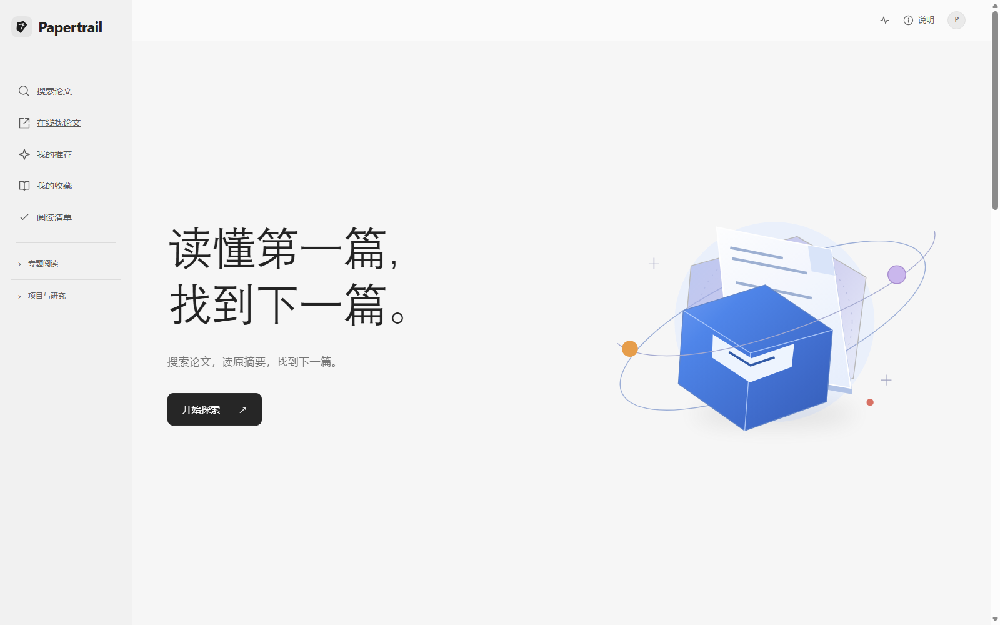
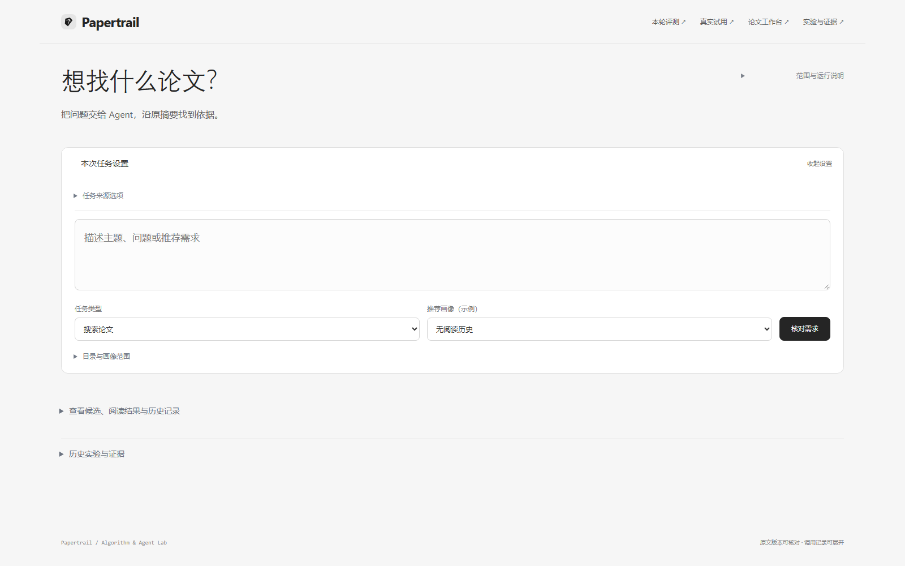
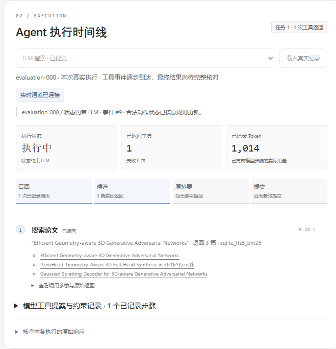

# Papertrail

论文检索 / 推荐与**可审计 Agent** 的本地实验项目。

一个 167 篇论文的阅读站（可搜索、收藏、读原摘要、内容推荐、备份），一个基于冻结万篇目录的真实 LLM Agent 实验台（状态约束 + 预算 + 逐步事件），以及一套带收据的离线实验（冷启动融合、生成式 SID、受控 Agent 评价）。

> 本地项目，不是托管服务。阅读站可以直接跑；Agent 实验台需要自备受许可的数据与模型权重（见"研究模式"）。

## 截图

| 首屏 | Agent 实验台 | 执行时间线 |
|---|---|---|
|  |  |  |

## 30 秒跑起来（阅读站）

需要 Python 3.12。

```powershell
python -m venv .venv
.\.venv\Scripts\pip install -r deploy\stage66\requirements.lock -r deploy\stage66\api-requirements.lock

$env:PAPERTRAIL_LOCAL_PREVIEW = '1'
$env:PAPERTRAIL_DATA_DIR = '.\visitor-data'
$env:PORT = '8791'
.\.venv\Scripts\python -m scripts.run_research77_workbench
```

打开 <http://127.0.0.1:8791/>，搜索 `retrieval` 试一下。

- `deploy/stage66/catalog` 自带 167 篇目录（元数据 + 原摘要），不依赖任何私有数据。
- 收藏保存在 `visitor-data/`，按浏览器凭据隔离；可用站内导出/导入备份。
- 第一次启动会加载目录与 TF-IDF，约 5–15 秒。

## 研究模式（为什么不能直接跑）

Agent 实验台（`research77/server.py`，8802）需要三样本仓库**不包含**的东西：

| 依赖 | 原因 |
|---|---|
| 万篇冻结目录与训练画像 | 来自 Scholar Inbox，**CC BY-NC-ND 4.0**，不可再分发 |
| 历史交互与用户级预测 | 用户派生数据 + 隐私 |
| Qwen2.5-1.5B 权重 | 体积大；模型许可另行适用（Apache-2.0） |

没有这些资产时，实验台会明确失败而不是用空数据兜底——这是刻意设计。

页面上的"Agent 接入说明"入口也会如实标注：当前没有执行模型。

## 目录结构

| 路径 | 职责 |
|---|---|
| `deploy/stage66/` | 阅读站后端（FastAPI）、167 篇目录、vendored 依赖 |
| `research77/` | 当前首屏与工作台展示层 |
| `research63`–`research76` | Agent 工具循环、约束、事件流、交接、报告等历次迭代 |
| `gsearch/` | 检索/推荐/Agent 的原生适配与状态约束 |
| `third_party/`、`deploy/*/api-vendor/` | 固定版本的上游实现与许可证 |
| `docs/` | 设计与阶段说明（`FINAL_SUMMARY_V85.md` 是总览） |
| `tests/` | 回归测试（部分需要研究环境） |
| `handoff/` | 交接说明与发布检查清单 |

## 测试

不需要私有资产的测试：

```powershell
.\.venv\Scripts\python -m unittest tests.test_reason_map
```

需要研究环境的测试（状态约束、预算、Agent 循环）依赖 `smolagents` 与冻结数据，参见 `docs/FINAL_SUMMARY_V85.md` 与 `docs/evidence/`。

## 实验与结论（摘要）

- **冷启动融合**：定位"冷论文因缺少协同信号被压低"，用支持门控 + 匹配消融在 dev 上把冷论文事件命中由 20 提到 50/33,557。
- **生成式 SID**：9,000 篇双 SID × 三种子 × 128/512 步受控对照；仍低于内容基线，按预声明规则停止加量（负结果保留）。
- **Agent 可靠性**：43 次唯一运行的只读审计 + 两处受控干预，结论是"框架可用、预算不是瓶颈、能力主导"。

这些结论的边界（不是线上指标、无真人相关性标签、dev 已多次使用）写在 `docs/FINAL_SUMMARY_V85.md`。

公开证据子集在 `docs/evidence/`（完整收据含私有路径与用户级数据，不随仓库发布）。

## 许可

代码以 **MIT** 发布，见 `LICENSE`。第三方组件与 vendored 依赖保留各自许可，见 `THIRD_PARTY_NOTICES.md`。

模型权重不随仓库分发；若自行下载，其许可适用：Qwen2.5-0.5B/1.5B 为 Apache-2.0，Qwen2.5-3B 为 Qwen Research Licence（仅研究用途）。

研究数据（万篇目录、训练画像、历史交互）**不在本仓库**，也不可按原 CC BY-NC-ND 4.0 条款再分发。

## 免责声明

本仓库是个人研究项目，不提供在线服务，不含真人标注数据，不承诺检索或推荐质量提升。页面中的"协议完成率"指任务是否按流程走完，不是语义正确率。
