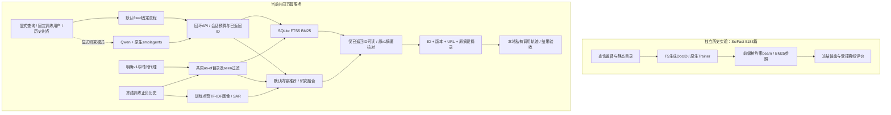

# 项目交付导航：生成式检索、论文推荐与可追溯工具链

这是个人算法与工程研究项目。主演示是在同一万篇官方arXiv v1目录上执行搜索、训练画像推荐、原摘要读取和引用输出；SciFact上的T5直接生成DocID为独立实验。当前默认SQLite BM25搜索、TF-IDF内容推荐、固定调度流程；冷论文融合与LLM策略保留显式研究入口。

从这里依次读：[完整演示](#完整演示) → [算法证据](ALGORITHM_EVIDENCE_2026.md) → [简历条目](RESUME_2026.md) → [面试讲解](INTERVIEW_2026.md)。阶段16旧材料仍封存在原文件，本版更新至阶段21。

## 完整演示

在PowerShell执行：

```powershell
Set-Location -LiteralPath '<repo>'
.\portfolio-demo.cmd
```

入口复用现有服务控制器：服务已在运行就复用，尚未运行则在后台启动；不安装依赖、不训练、不下载模型、不加载LLM。需当前电脑已准备的本地私有资产和`.cache/stage17/runtime`。成功exit0，未完成完整链路exit1，每次新建输出目录并保留失败，不静默补结果。

输出提示指向忽略的 `data/stage22-delivery/run-*/DEMO.md` 与 `result.json`。前者按步骤展示原响应，后者包括任务/选择规则、用户、历史时点、服务实例、每次工具参数/结果/耗时、全部原摘要和最终引用。它们含个人派生结果，只在本机查看，不随源码或简历发送。演示结束后服务继续运行；需要关闭可执行`.\unified-service.cmd stop`。

演示顺序是5次真实工具调用：

1. `search_papers`：默认查询取自训练截止前、该用户未读的warm目录标题，按固定hash选择，是已知条目演示；不是收集的真人自然主题问题。
2. `recommend_papers`：显式绑定由训练正反馈画像用户集合固定hash选出的用户，content推荐；验收拒绝把冷用户流行度回退称为个性化。
3. 两次`read_paper`：分别读取一篇搜索结果和另一篇推荐结果，检查原始响应hash、明确v1及原生解析器文字。
4. `finalize`：输出两篇论文的ID、版本、标题、来源链接和原摘要摘录；取句由固定流程完成，LLM调用0。

自定义查询可以用`.\portfolio-demo.cmd --query "retrieval augmented generation"`，它不保证找到论文。组合演示要求搜索和推荐各有一篇；不足时保留轨迹并非零退出，即使底层固定流程合法提交了部分结果，也不冒充完整演示。

## 架构与数据边界



T5没有参与当前万篇请求；service不含LLM。fixed通过既有ToolClient调用HTTP，研究LLM入口才执行smolagents循环。图中的来源核验只证明版本与原摘要可追溯，不表示全文理解、语义相关性或观点真伪。

## 当前环境和运行入口

| 用途 | 已验证环境 | 入口与范围 |
|---|---|---|
| 当前完整演示与API | 独立CPython3.12.3、Torch2.6.0+cpu，57包；无需GPU | portfolio-demo.cmd；服务8766 |
| 旧推荐三方案演示 | 原stage6环境只读桥接共享CUDA包 | demo.cmd；stage16原封存入口 |
| 同机迁移证据 | 新CPU运行时/新路径481资产，签名与三路轨迹一致 | [阶段17说明](ISOLATED_REPLAY.md)；原回放拒绝覆盖 |
| Qwen策略研究 | 旧stage6/shared CUDA、Transformers4.57.1、smolagents1.22.0、冻结1.5B权重 | state-agent-isolated-demo.cmd；不是完全隔离GPU环境 |
| 本轮快速交付校验 | 当前CPU运行时、纯读取 | portfolio-check.cmd；不触发训练或重新跑LLM |

依赖来源与哈希锁在reports/stage17、requirements-stage17文件及[第三方通知](../THIRD_PARTY_NOTICES.md)；不需要为了演示重装共享Torch。8765旧推荐服务独立，完整演示只使用8766。查看状态用`.\unified-service.cmd status`。

## 分层复现

**当前电脑重演**：运行portfolio-demo.cmd，检查两篇原摘要和result.json五次真实调用；演示耗时不是正式延迟基准。

**交付完整性核查**：运行portfolio-check.cmd，核对本轮封存文件、83项源JSON事实、引用源hash与文档链接；不会覆写报告或创建LLM评价。它不重新计算全部历史原始排名，也不等于另一台机器安装验收。

**完整历史资产与代码回归**：本轮封存时已调用阶段3—21冻结检查、原481迁移资产核查及125项测试。旧v1故障用例会修改共享类schema，完整suite使用阶段21的逐测试清理夹具；不要把裸unittest顺序运行造成的污染当作新模型结果。本轮封存命令为旧只读环境 `python -m scripts.verify_portfolio_delivery --seal`，已有收据拒绝覆盖，后续仅使用`--check`。

**从空机器重建研究**：源码不包含反馈、训练权重、原响应和私有派生数据。先合法获取资产、遵守Scholar Inbox非商用/派生分发边界，再按旧阶段协议在新的实验目录准备；固定锁/下载器和阶段17说明提供依赖线索，不承诺任意新机器一键重训。真实第二台机器、跨系统及新独立反馈窗口仍未验收。

## 三个展示重点

先运行完整演示并打开私有DEMO.md，用原论文ID/版本/URL解释真实来源；再展示冷论文融合的匹配消融和完整未来点赞分母；最后展示Agent负结果、schema污染作废及修复后重跑，解释为何可靠的固定流程保留默认。数值及来源统一见[核心证据](ALGORITHM_EVIDENCE_2026.md)。

项目已有工程成果可写简历。人工相关性判断仍为0、在线曝光/CTR/转化/广告竞价和生产QPS未验证；没有用草拟查询或受控标题定位填补这些证据。
