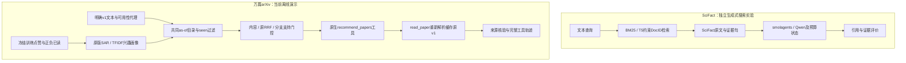

# 项目一页纸：生成式论文检索与个性化推荐 Agent

**定位：生成式检索、推荐融合及可追溯工具链的离线研究项目。** 已有可运行演示和冻结实验；目前不包含广告竞价、真实曝光日志或线上业务指标。开发与运行环境为Windows / Python3.12 / RTX4060 Laptop8GB，当前推荐演示使用CPU。

## 两条已实现的链路

| 链路 | 数据与算法 | 工具与验证 |
|---|---|---|
| 生成式搜索与证据核验 | SciFact5,183篇文档；T5 query→DocID、约束beam search、BM25及融合；完整/压缩ID、生成查询等对照 | smolagents/Qwen、搜索/读取/证据工具及调用预算；生成式方法尚未超过强BM25参照 |
| 个性化论文推荐 | 10,000篇官方明确arXiv v1；原版SAR、原生TFIDF内容、RRF及冷论文分支门控 | 逐时点共同目录和train正负seen过滤；推荐→原v1摘要读取、原始响应hash及原生解析器核验 |

两条链路使用各自的文档ID、语料、评价与工具状态。当前一键演示展示第二条链路，没有将SciFact微调权重应用到万篇arXiv目录，也没有验证统一LLM策略的质量提升。

## 可核验成果

| 工作 | 结果与适用范围 |
|---|---|
| 万篇扩容与资源门槛 | 8,000篇有训练赞、1,000篇无赞旧论文、1,000篇按日进入；1k→5k→10k逐级通过；万篇原拟合峰值工作集2.275GiB |
| 冷论文机制诊断 | tuning中内容命中的20次冷论文事件，19次被原RRF挤出Top10；零协同分仍按ID获得尾部排名，内容贡献同时被融合权重削弱 |
| 冷论文融合 | tuning选alpha0.25后冻结；描述性dev冷论文命中20→50/33,557事件，热论文65→64/15,976；整体用户宏平均NDCG0.000875→0.001331 |
| 不确定性与成本 | 主NDCG差+0.000457，用户配对95%区间[+0.000205,+0.000775]；同请求均值/P95成本为内容1.26/1.28倍，预定保护通过 |
| 无损过滤加速 | 另一固定请求样本中，原融合均值10.98→7.26ms；12份完整预测、568,948个事件—方法Top10排名完全相同 |
| 原生组件复用 | Recommenders SAR、sklearn向量化/归一化、NumPy索引、arxiv.py解析及smolagents工具；版本/许可/源码blob有记录 |

阶段14和15的时间样本与机器运行状态不同，绝对毫秒数不直接跨阶段比较。阶段15只在重复使用的dev上观察到收益，尚无新独立时段；默认保留内容推荐，研究融合显式运行。标题/摘要来源核验不代表全文理解或观点真伪核验。

## 交付入口

在当前项目目录执行 `demo.cmd`，自动从训练画像用户中按固定hash选人，不需要手填用户ID、不下载新资产；三路推荐与各自第一篇的原v1读取结果写到忽略的 `data/showcase/run-*/DEMO.md` 和 `demo.json`。

[复现说明](REPRODUCIBILITY.md) · [简历条目与证据](RESUME.md) · [面试讲解](INTERVIEW.md) · [阶段15正式报告](../reports/阶段15_冷论文融合归因与对照.md)
